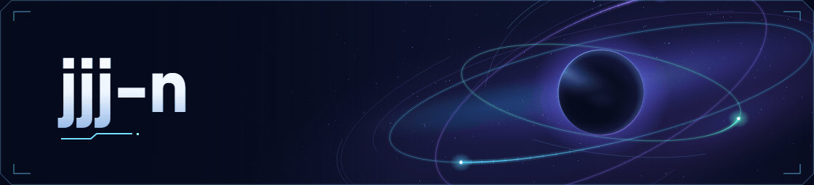
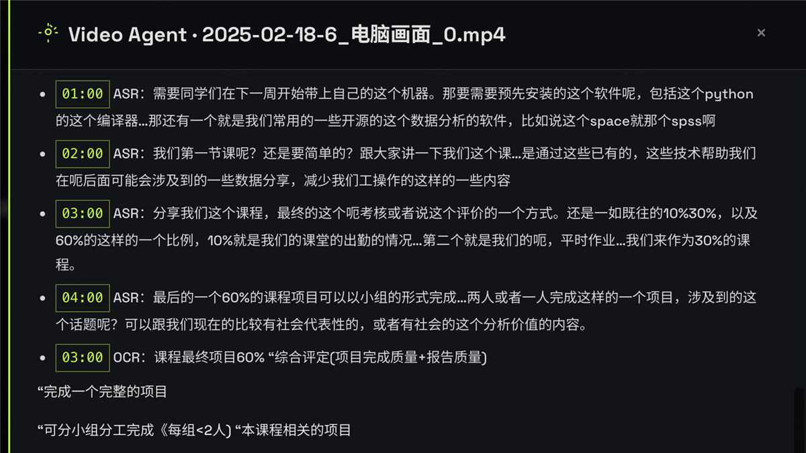

# Go 后端 · AI 应用开发

做过语音 Agent 的实时交互和长期记忆评测，也参与 WeKnora、go-redis 和 LangChainGo 的开源开发。

## 精选开源贡献

### WeKnora

- **租户级记忆管理**。新增管理员接口和审计记录，防止记忆清空后旧的后台任务写回数据。 [#4954](https://github.com/Tencent/WeKnora/pull/4954)
- **IM 回复语言**。为每个渠道增加固定回复语言设置，覆盖管理界面、配置存储和问答链路。 [#3455](https://github.com/Tencent/WeKnora/pull/3455)
- **Agent 流式结束**。修复 Agent 执行完成后 IM 仍在等待的问题，补充取消、终止事件缺失和异步问答的回归测试。 [#3124](https://github.com/Tencent/WeKnora/pull/3124)

### 其他开源贡献

- **go-redis**。全双工连接初始化被限流拒绝时，阻止回退到主连接池触发二次拨号。 [#4272](https://github.com/redis/go-redis/pull/4272)
- **LangChainGo**。补齐 Anthropic 请求成功后的结束回调，让调用追踪能正常关闭 span。 [#1538](https://github.com/tmc/langchaingo/pull/1538)
- **ArcadeDB**。修复快照切换中断后的恢复流程，避免重试误删已安装的快照文件。 [#7940](https://github.com/ArcadeData/arcadedb/pull/7940)

## 代表项目

### DoVideoAI · 长视频内容理解 Agent

把长视频里的语音和画面文字整理成带时间戳的证据。Agent 可以检索这些证据、回答追问，并回溯到原视频片段。分析任务支持异步执行和断点恢复。

[项目仓库](https://github.com/jjj-n/DoVideoAI) · [评测方法与结果](https://github.com/jjj-n/DoVideoAI/tree/master/benchmark)

---

**技术栈**　Go · gRPC · Redis · PostgreSQL · Python · Java / Spring Boot
